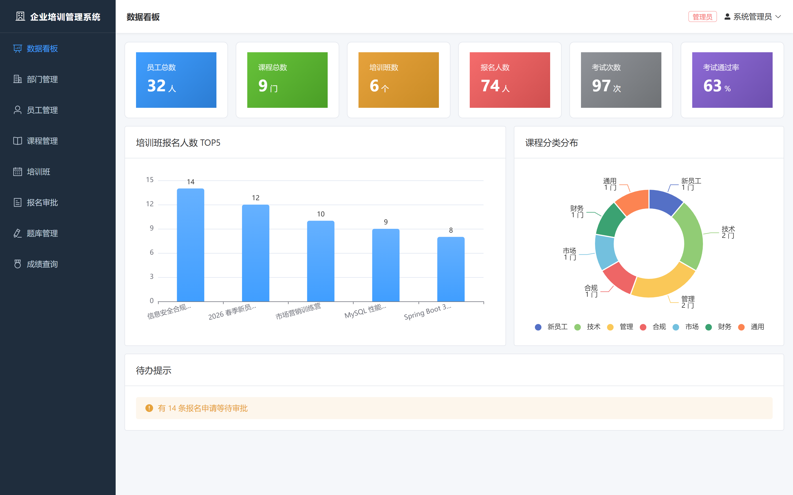
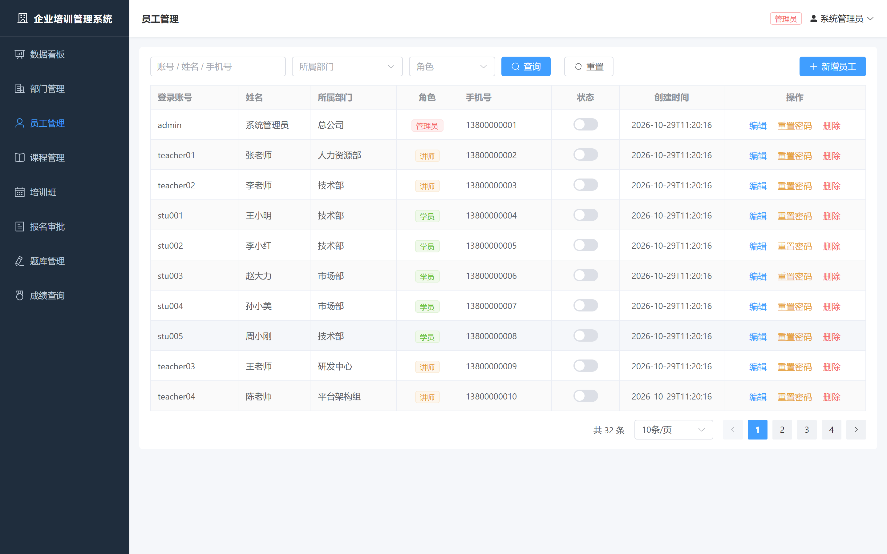
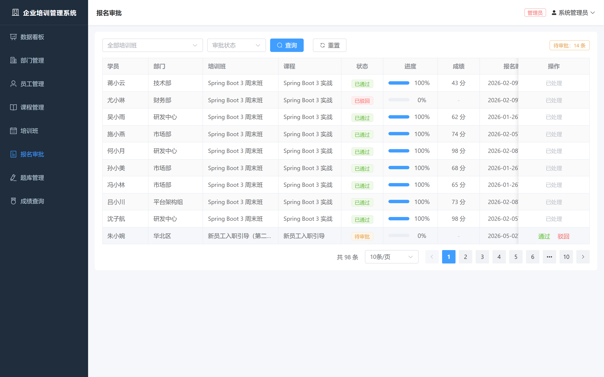
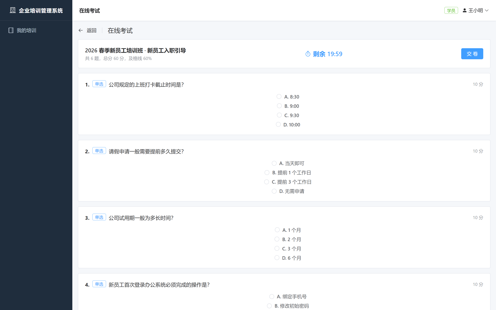
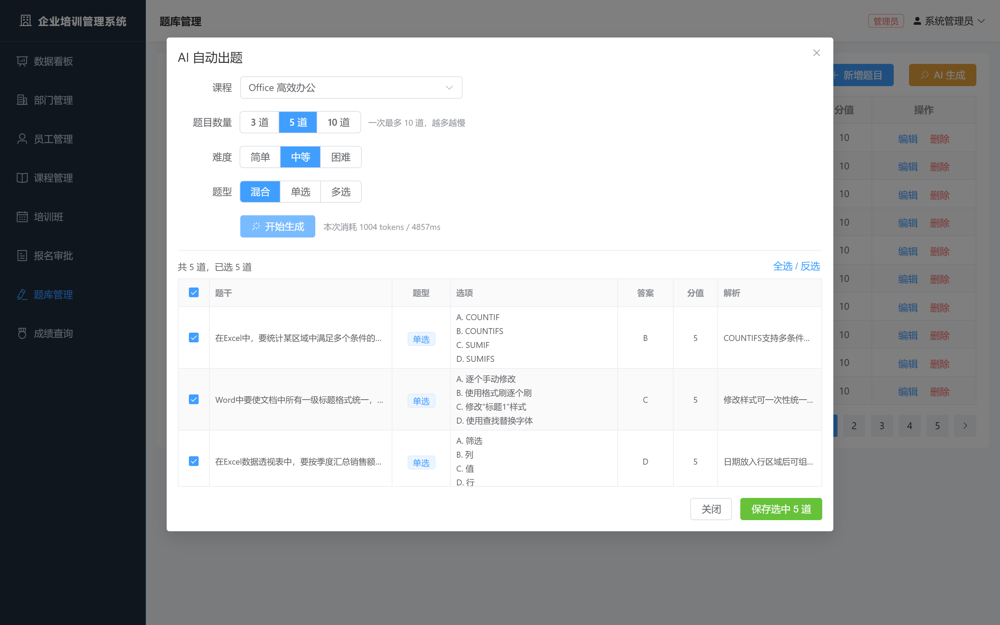
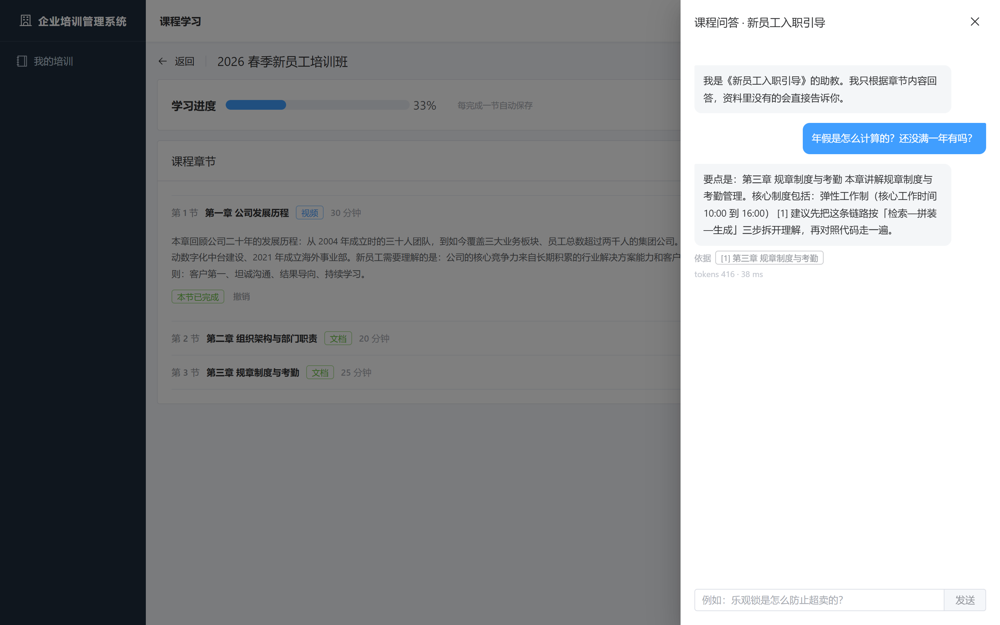

# 企业培训管理系统 · Enterprise Training Management


一套面向中小企业的培训管理后端 + 前端一体化系统，覆盖 **建课 → 开班 → 报名 → 审批 → 学习 → 考试 → 成绩 → 看板** 的完整闭环，
并在业务之上集成了 **AI 自动出题、AI 考试评语、课程知识库问答（RAG）** 三项大模型能力。

前端构建产物直接输出到后端 `static` 目录，最终打包为 **单个 jar**，`java -jar etm.jar` 一条命令即可运行（同源部署，无跨域）。

## 预览

| 数据看板 | 员工管理 |
|---|---|
|  |  |

| 报名审批 | 在线考试 |
|---|---|
|  |  |

| AI 自动出题 | 课程问答（RAG，带引用） |
|---|---|
|  |  |

## 功能

**组织与权限**
- 部门树（两级以上自关联）、员工分页/筛选/启停用/重置密码
- 三种角色：管理员 `ADMIN`、讲师 `TEACHER`、学员 `STUDENT`，接口级鉴权（Sa-Token）
- 数据级越权防护：学员只能操作自己的报名记录与学习进度

**培训主流程**
- 课程与章节管理（视频/文档两种章节类型，上下架状态）
- 培训班：绑定课程、名额、起止时间、`草稿 → 已发布 → 已结束` 状态机
- 报名：名额校验、重复报名拦截、`待审批 → 通过/驳回/取消` 状态机，驳回后可重新报名
- 学习进度：按章节勾选记录，**进度由后端重算**，前端无法伪造
- 在线考试：随机抽题、限时、自动判分、及格判定、支持补考（多次成绩取最高）
- 成绩查询与统计看板（6 项指标 + 班级报名 TOP5 + 课程分类分布）

**AI 能力（基于 DeepSeek / 任意 OpenAI 兼容接口）**
- AI 自动出题：按课程 + 难度 + 题型生成题目，强制 JSON 输出并在后端校验选项与答案合法性，人工确认后入库
- AI 考试评语：针对**某一次考试**生成评语，自动带「第 N 次考试」「上一次 X 分」的上下文
- 课程知识库问答：章节正文切片 → BM25 检索 Top3 → 生成答案并返回引用编号，检索不到时不调用模型（零成本兜底）

## 技术栈

| 层次 | 技术 |
|---|---|
| 后端 | Java 17、Spring Boot 3.2.5、MyBatis-Plus 3.5.5、Sa-Token 1.37、Hutool、Lombok |
| 数据库 | MySQL 5.7 / 8.0（9 张表） |
| 前端 | Vue 3、Vite 5、Element Plus、Pinia、Vue Router、Axios、ECharts |
| 打包部署 | Maven + Vite，单 jar 同源部署 |

## 快速开始

### 1. 环境要求

- JDK 17+
- MySQL 5.7+（脚本兼容 5.7，使用 `utf8mb4_general_ci`）
- Node.js 18+（仅前端开发需要）
- Maven 3.6+

### 2. 初始化数据库

```bash
mysql -uroot -p --default-character-set=utf8mb4 -e "source src/main/resources/db/init.sql"
```

脚本会自动创建 `enterprise_training` 库、9 张表，并写入演示数据（32 个账号、9 门课程、10 个培训班、98 条报名、47 道题、97 条考试记录）。

### 3. 启动后端

```bash
mvn spring-boot:run
# 默认 http://localhost:8080
```

### 4. 启动前端（开发模式）

```bash
cd frontend
npm install
npm run dev
# http://localhost:5173，/api 已代理到 8080
```

### 5. 打成单 jar

```bash
cd frontend && npm run build      # 产物输出到 src/main/resources/static
cd .. && mvn -DskipTests package  # 产物 target/etm.jar
java -jar target/etm.jar
```

## 配置

以下配置项均支持环境变量覆盖，**请勿把真实密钥提交到仓库**：

| 变量 | 默认值 | 说明 |
|---|---|---|
| `DB_PASSWORD` | `xzn051222` | 数据库密码（演示默认值，请替换为你自己的） |
| `AI_API_KEY` | 空 | DeepSeek 或其他 OpenAI 兼容服务的 Key；为空时 AI 接口自动降级为提示，不影响主流程 |
| `AI_BASE_URL` | `https://api.deepseek.com` | 也可指向本地 Ollama：`http://localhost:11434/v1` |
| `AI_MODEL` | `deepseek-chat` | 模型名，如 `qwen2.5:7b` |

演示账号（密码统一 `123456`）：

| 账号 | 角色 |
|---|---|
| `admin` | 管理员 |
| `teacher01` ~ `teacher06` | 讲师 |
| `stu001` ~ `stu025` | 学员（`stu025` 为禁用状态示例） |

## 项目结构

```
├── src/main/java/com/etm
│   ├── common/        # 统一响应 Result、分页 PageResult、全局异常、当前用户
│   ├── config/        # MyBatis-Plus、Sa-Token、自动填充、AI 配置
│   ├── controller/    # 13 个 REST 控制器
│   ├── service/       # 业务逻辑（含事务、乐观锁、状态机）
│   ├── mapper/        # MyBatis-Plus Mapper
│   ├── entity/ dto/ vo/
│   └── ai/            # AiClient 封装、出题、评语、RAG 检索
├── src/main/resources
│   ├── db/init.sql    # 建库建表 + 演示数据
│   └── application.yml
└── frontend/          # Vue 3 前端工程
```

## 设计要点

1. **重复报名用唯一索引兜底** —— 应用层先查重，`uk_class_user(class_id, user_id)` 挡住并发下的第二条插入；取消报名只改状态位不物理删除，重新报名时复用原记录。
2. **名额超卖用乐观锁** —— 审批通过时 `enrolled_count + 1` 带 `version` 条件，更新影响行数为 0 就抛业务异常提示刷新重试，而不是写脏数据。
3. **学习进度由后端计算** —— 前端只提交"勾选/取消"动作，进度 = 已完成章节 / 总章节，改请求也改不动。
4. **AI 调用统一封装** —— 连接与读取超时、指数退避重试、错误分级（可重试/不可重试）、未配置密钥自动降级，主流程不受大模型可用性影响。
5. **RAG 不用向量库** —— 课程章节量级小，用 BM25（中文二元组分词）就够，检索层做成可替换接口，将来换向量检索只改一个方法。

## 已知限制

本项目为课程设计作品，若用于生产还需补充：细粒度权限表、操作审计日志、接口幂等与限流、单元测试与 CI、多实例部署下的缓存与分布式锁。

## License

[MIT](LICENSE) © 2026 许子诺
